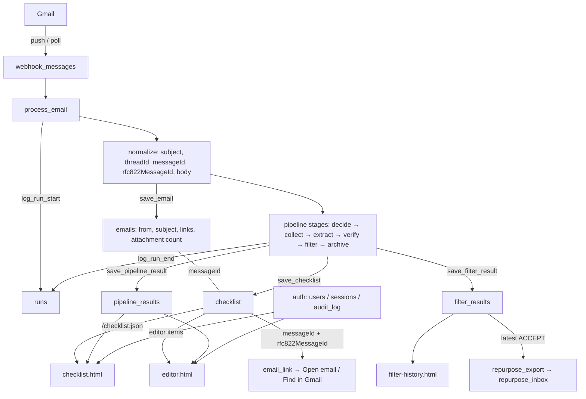
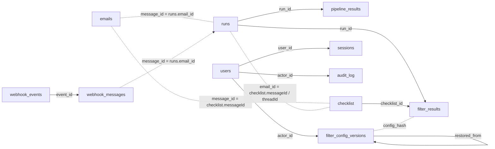
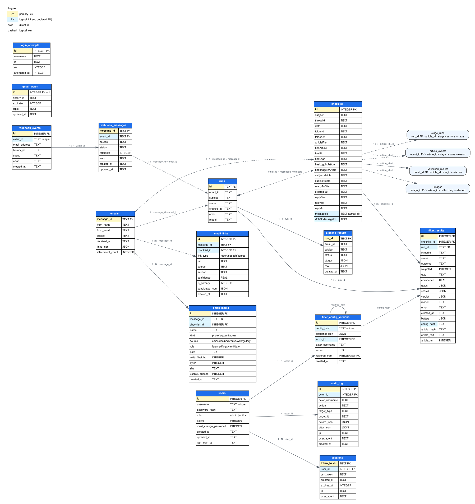

# Database flow — `data/msme.sqlite3`

_How one email becomes a checklist row, a run trace, a filter verdict and a published draft — and
which table holds each step. Measured 2026-11-06._

The service uses one SQLite file: **`data/msme.sqlite3`**. Docker mounts `./data:/app/data`, so the
container and the host read the same file. `msme/db.py` creates and migrates the tables at startup
(`init_db()`).

## 1. End-to-end flow



## 2. Tables

| Table | Holds | Written by | Read by |
|---|---|---|---|
| **`checklist`** | one row per processed email: the 14 checklist columns + reply + Gmail ids | `pipeline` → `checklist.save_checklist` → `db.save_checklist` | `/checklist.json`, editor, filter history, repurpose export |
| **`emails`** | one compact row per received email: `message_id`, from name/email, subject, `received_at`, `links_json`, `attachment_count` (no body) | `pipeline` → `db.save_email`; `tools/backfill_emails.py` | receive rows on the AI Model page (`/ai-model.html`, sender column after backfill) |
| **`runs`** | one row per receive attempt: `email_id` (Gmail id), subject, status, model, error | `db.log_run_start` / `db.log_run_end` | logs page, editor |
| **`pipeline_results`** | the full stage trace + the row JSON for one run | `db.save_pipeline_result` | flow page, editor |
| **`filter_results`** | one filter verdict per run: outcome, score, gates, battery, article hash/text | `db.save_filter_result` (receive + filter re-runs) | filter history, editor, repurpose export |
| **`filter_config_versions`** | every filter-config save/restore snapshot | filter service | config history |
| **`gmail_watch`** | the single Pub/Sub watch (history id, expiry) | webhook / scheduler | webhook renewal |
| **`webhook_events`** | one Pub/Sub event (dedupe) | `webhook_gmail` | webhook receiver |
| **`webhook_messages`** | the queue of Gmail ids to process | `webhook_gmail` / queue | receive queue |
| **`users`** | admin/editor accounts + scrypt hash | `auth` | login, `/users.html` |
| **`sessions`** | hashed session tokens + CSRF | `auth` | auth gate |
| **`login_attempts`** | lockout counters | `auth` | login |
| **`audit_log`** | who changed what (users, filter config) | `auth`, filter service | audit page |

Measured row counts at the time of writing: `checklist` **241**, `emails` **0** (new table; old
emails are not backfilled), `runs` **355**, `pipeline_results` **251**, `filter_results` **24**,
`filter_config_versions` **2**, `users` **3**, `sessions` **4**, `audit_log` **68**,
`webhook_events` **36**, `webhook_messages` **13**.

**Cost readers (2026-11-07, `T-055`):** `db.cost_receive_rows()` (tokens from
`pipeline_results.stages.tokens.detail`), `db.cost_filter_rows()` (`filter_results.verdict.usage`)
and `db.cost_repurpose_rows()` (`repurpose_runs.usage_json`) feed `msme/cost.py` →
`/api/costs.json` + the AI Model **Cost** tab. The engine writes usage into `run.json` and
`repurpose_runs.usage_json`.

### 2.1 Connections — how the tables join

There are **no declared foreign keys** in this SQLite file; every link is made by an ID in code.



| From | To | Key | Meaning |
|---|---|---|---|
| `emails.message_id` | `checklist.messageId` | 1:1 | the received-email envelope for a checklist row |
| `emails.message_id` | `runs.email_id` | 1:1 | the run that processed that email |
| `pipeline_results.run_id` | `runs.id` | 1:1 | one stage trace per run |
| `filter_results.checklist_id` | `checklist.id` | N:1 | the latest row is the current verdict |
| `filter_results.run_id` | `runs.id` | N:1 | the run that produced the verdict |
| `filter_results.threadId` | `checklist.threadId` | N:1 | convenience link |
| `webhook_messages.event_id` | `webhook_events.event_id` | N:1 | one Pub/Sub event can carry many messages |
| `webhook_messages.message_id` | `runs.email_id` | 1:1 | the queue id is the Gmail message id |
| `runs.email_id` | `checklist.messageId` / `checklist.threadId` | logical | the editor joins by `threadId`; N-6 backfill used `pipeline_results.email_id` |
| `sessions.user_id` | `users.id` | N:1 | a login session belongs to one user |
| `audit_log.actor_id` | `users.id` | N:1 | nullable for system actions |
| `filter_config_versions.actor_id` | `users.id` | N:1 | who saved/restored the config |
| `filter_config_versions.restored_from` | `filter_config_versions.id` | self | restore chain |
| `filter_results.config_hash` | `filter_config_versions.config_hash` | logical | the filter battery snapshot used |
| `audit_log.target_id` | varies | polymorphic | `target_type` says which table |

Note: `checklist` has **no `run_id` column**. The run is found through
`checklist.messageId`/`threadId` → `runs.email_id`, and the row's `_runId` is kept inside
`pipeline_results.row` (JSON).

### 2.2 Table graph — every column and every link



Full size: [`database-schema.svg`](database-schema.svg) · PNG: [`database-schema.png`](database-schema.png) ·
source: [`database-schema.dot`](database-schema.dot)

Yellow = primary key. Blue = logical link (this SQLite file declares no foreign keys). Solid edge = a
direct id; dashed edge = a logical join.

## 3. The checklist row — the contract

`msme/db.py:41` defines the 14 columns, in this order:

```text
subject, threadId, date, folderId, folderUrl, articleFile,
hasArticle, hasPic, hasLogo, hasLogoInArticle, hasImageInArticle,
subjectMatch, subjectScore, readyToFilter
```

Everything after these is an **extra column**, not part of the CSV/report contract:

| Extra column | Purpose |
|---|---|
| `replySent` · `replyTo` · `replyAt` | whether/when the ask email was sent |
| `messageId` | Gmail API message id (N-6) |
| `rfc822MessageId` | the email's own `Message-ID` header (N-6) |

`db.init_db()` adds a missing column with `ALTER TABLE … ADD COLUMN`; the code never assumes an old
database has it.

## 4. Where the N-6 email link lives

The **URL is not stored**. Two ids are stored, and the link is built when the page loads:

1. `normalize.build_email_model` reads `messageId` + `rfc822MessageId`
   (`msme/receive/normalize.py:336-337`).
2. The pipeline puts both in the row (`msme/receive/pipeline.py:1372-1373`).
3. `db.save_checklist` writes them after the 14-column insert (`msme/db.py:247`).
4. `/checklist.json` and the editor call `email_link.enrich_row`
   (`msme/receive/dashboard.py:859`, `msme/receive/editor_data.py:209`).
5. `email_link.gmail_urls` builds:
   - `#all/<messageId>`
   - `#search/rfc822msgid:<encoded Message-ID>`
6. The detail panels render **Open email ↗** and **Find in Gmail**.

Old rows: `tools/backfill_message_ids.py` filled `messageId` for **241** rows from
`pipeline_results`; those rows have no `rfc822MessageId`, so they show only **Open email**.

## 5. Run statuses

| Where | Values |
|---|---|
| `runs.status` | `running` · `success` · `needs_human` · `ai_error` · `error` |
| `filter_results.status` | `ok` · `error` |
| `filter_results.outcome` | `ACCEPT` · `EDITOR REVIEW` · `REJECT` · `ERROR` |

A `filter_results` row is linked to a checklist row by `checklist_id`; the latest one is what the
dashboard shows.

## 6. Reading it safely

The database is live. Read-only commands do not change it:

```bash
sqlite3 -readonly data/msme.sqlite3
```

```sql
.tables
.schema checklist
.headers on
.mode box
select id, subject, messageId from checklist order by id desc limit 5;
```

The `-wal` and `-shm` files are part of SQLite's write-ahead log. Do **not** delete them while the app
is running. For a backup, stop writes or use SQLite's backup:

```bash
sqlite3 data/msme.sqlite3 ".backup /tmp/opencode/msme-backup.sqlite3"
```

## 7. Who writes what, in one line each

- **Receive:** `runs` start → `pipeline_results` → `checklist` → `filter_results` → `runs` end.
- **Filter re-run:** a new `filter_results` row on the same `checklist_id`.
- **Config change:** `filter_config_versions` + `audit_log`.
- **User change:** `users` + `audit_log`; login writes `sessions` / `login_attempts`.
- **Webhook:** `webhook_events` + `webhook_messages`; the queue feeds `process_email`.

## 8. Code map

| Concern | File |
|---|---|
| schema, migrations, writers | `msme/db.py` |
| 14-column row + save | `msme/receive/checklist.py` |
| stage trace + row save | `msme/receive/pipeline.py` |
| filter verdict save | `msme/filtering/filter_service.py` · `filter_log.py` |
| dashboard reads | `msme/receive/dashboard.py` |
| editor reads | `msme/receive/editor_data.py` |
| Gmail links | `msme/receive/email_link.py` |
| backfill | `tools/backfill_message_ids.py` |

## 9. Full schema

_As created by `db.init_db()` plus the `ALTER TABLE` migrations. SQLite internals
(`sqlite_sequence`, `sqlite_stat1`, `sqlite_stat4`) are omitted._

```sql
CREATE TABLE runs (
    id TEXT PRIMARY KEY,
    email_id TEXT,
    subject TEXT,
    status TEXT,
    created_at TEXT,
    error TEXT,
    model TEXT
);

CREATE TABLE checklist (
    id INTEGER PRIMARY KEY AUTOINCREMENT,
    subject TEXT, threadId TEXT, date TEXT, folderId TEXT, folderUrl TEXT, articleFile TEXT,
    hasArticle TEXT, hasPic TEXT, hasLogo TEXT, hasLogoInArticle TEXT, hasImageInArticle TEXT,
    subjectMatch TEXT, subjectScore TEXT, readyToFilter TEXT,
    created_at TEXT,
    replySent TEXT, replyTo TEXT, replyAt TEXT,          -- migration
    messageId TEXT, rfc822MessageId TEXT                 -- migration (N-6)
);

CREATE TABLE emails (
    message_id TEXT PRIMARY KEY,        -- Gmail message id
    from_name TEXT,
    from_email TEXT,
    subject TEXT,
    received_at TEXT,                   -- first time we saw it (UTC ISO)
    links_json TEXT,                    -- JSON array
    attachment_count INTEGER DEFAULT 0
);

CREATE TABLE pipeline_results (
    run_id TEXT PRIMARY KEY,
    email_id TEXT,
    subject TEXT,
    status TEXT,
    stages TEXT,        -- JSON
    row TEXT,           -- JSON (includes _runId)
    created_at TEXT
);

CREATE TABLE filter_results (
    id INTEGER PRIMARY KEY AUTOINCREMENT,
    checklist_id INTEGER,
    run_id TEXT,
    threadId TEXT,
    status TEXT,
    outcome TEXT,
    weighted INTEGER,
    gate TEXT,
    confidence REAL,
    gates TEXT, scores TEXT, verdict TEXT,
    model TEXT,
    error TEXT,
    created_at TEXT,
    battery TEXT, config_hash TEXT, article_hash TEXT, article_text TEXT, article_len INTEGER  -- migration
);

CREATE TABLE gmail_watch (
    id INTEGER PRIMARY KEY CHECK (id = 1),
    history_id TEXT, expiration INTEGER, topic TEXT, updated_at TEXT
);

CREATE TABLE webhook_events (
    id INTEGER PRIMARY KEY AUTOINCREMENT,
    event_id TEXT UNIQUE, email_address TEXT, history_id TEXT,
    status TEXT, error TEXT, created_at TEXT
);

CREATE TABLE webhook_messages (
    message_id TEXT PRIMARY KEY,
    event_id TEXT, source TEXT, status TEXT, attempts INTEGER DEFAULT 0,
    error TEXT, created_at TEXT, updated_at TEXT
);

CREATE TABLE users (
    id INTEGER PRIMARY KEY AUTOINCREMENT,
    username TEXT UNIQUE NOT NULL COLLATE NOCASE,
    password_hash TEXT NOT NULL,
    role TEXT NOT NULL CHECK (role IN ('admin','editor')),
    active INTEGER NOT NULL DEFAULT 1,
    must_change_password INTEGER NOT NULL DEFAULT 0,
    created_at TEXT, updated_at TEXT, last_login_at TEXT
);

CREATE TABLE sessions (
    token_hash TEXT PRIMARY KEY,
    user_id INTEGER NOT NULL,
    csrf_token TEXT NOT NULL,
    created_at TEXT, expires_at INTEGER NOT NULL,
    ip TEXT, user_agent TEXT
);

CREATE TABLE login_attempts (
    id INTEGER PRIMARY KEY AUTOINCREMENT,
    username TEXT, ip TEXT, ok INTEGER NOT NULL,
    attempted_at INTEGER NOT NULL
);

CREATE TABLE audit_log (
    id INTEGER PRIMARY KEY AUTOINCREMENT,
    actor_id INTEGER, actor_username TEXT,
    action TEXT NOT NULL, target_type TEXT, target_id TEXT,
    before_json TEXT, after_json TEXT,
    ip TEXT, user_agent TEXT, created_at TEXT
);

CREATE TABLE filter_config_versions (
    id INTEGER PRIMARY KEY AUTOINCREMENT,
    config_hash TEXT NOT NULL,
    snapshot_json TEXT NOT NULL,
    actor_id INTEGER, actor_username TEXT,
    action TEXT NOT NULL,
    restored_from INTEGER,
    created_at TEXT
);

CREATE INDEX idx_sessions_expires ON sessions(expires_at);
CREATE INDEX idx_attempts_time ON login_attempts(attempted_at);
CREATE INDEX idx_checklist_message_id ON checklist(messageId);
```
