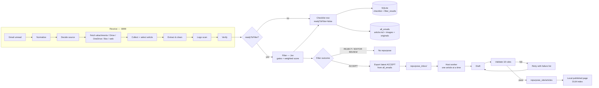

# Workflow — receive → filter → repurpose → publish

_Last updated 2026-10-29._

This is the operating map: what runs, what is stored, what each status means, and where the
hand-off points are. **Seven worked examples** of the receive stages, using real emails with
different structures, are in [`RECEIVE-WORKFLOW-7-EMAIL-EXAMPLES.md`](RECEIVE-WORKFLOW-7-EMAIL-EXAMPLES.md).
Receive and Filter are one app on **:8899**. Repurpose is the external engine dashboard on
**:8765**. "Publish" currently means a local page in `repurpose_site/` — not a WordPress post.

## 1. End-to-end flow

## 2. Receive

### Stages

1. **Gmail** — unread inbox messages matching `in:inbox is:unread -category:promotions`.
2. **Normalize** — subject/from/date/body, attachments, links, resolved tracking links.
3. **Decide** — AI chooses the source: attachment, Drive, OneDrive, Box, body or web page.
4. **Fetch** — downloads the chosen sources and media.
5. **Collect + select** — collects all sources first, then the AI selects the article.
6. **Extract** — verbatim article + evidence.
7. **Logo scan** — deterministic image check inside the document.
8. **Verify** — headline, subject match, media flags, `readyToFilter`.
9. **Checklist** — 14-column row saved to SQLite.
10. **Archive** — article `.md`, `images/`, `originals/` saved to `all_emails/`.
11. **Filter** — runs automatically only when `readyToFilter=true` (next section).

### Receive status (dashboard column)

| Status | Meaning |
|---|---|
| `processing…` | a run is active |
| `received` | receive completed successfully |
| `receive issue` (`needs_human`) | no source could be fetched, or a Drive file was view-only/refused; the cover note is not archived as the article |
| `error` | the run failed (AI/provider/error); see the run log |
| `old` | black badge: a newer row exists for the same email/thread |

The main table shows current rows first; old rows are kept in black. KPIs count only the latest
row per thread.

### Readiness flags

| Flag | Meaning |
|---|---|
| `hasArticle` | an article was extracted |
| `hasPic` | a real photo file is present (email/Drive/web/asset) |
| `hasLogo` | a **standalone** logo asset is present |
| `hasLogoInArticle` | a logo is embedded inside the article document |
| `hasImageInArticle` | a non-logo image is embedded inside the article document |
| `subjectMatch` / `subjectScore` | email subject vs extracted headline |
| `readyToFilter` | `hasArticle AND (hasPic OR hasLogo OR hasImageInArticle) AND subjectScore > 60` |

## 3. Filter

Jev evaluates the extracted article. The rubric is editable in **Config → Config Filter**.

- **3 critical gates** — royalty, religion, race. A gate fires when its defect probability
  reaches the configured `thr`; a fired gate rejects before the weighted score.
- **11 weighted criteria** — each `good × weight`; weights total 100%.
- **Accept threshold** — editable 0–100 (default 60); a weighted score at or above it accepts.
- **Borderline band** — a score in the configured band may route to **EDITOR REVIEW**.
- **Filter error** — the receive row is kept; the filter is retried/re-run; it never fails receive.

| Filter status | Meaning |
|---|---|
| `ACCEPT` | no critical gate fired and the weighted score passed |
| `REJECT` | a critical gate fired, or the weighted score was below the cut |
| `EDITOR REVIEW` | a gate/weighted borderline needs a human |
| `error` | Jev failed; the verdict is recorded as an error |
| `—` | not filtered (not ready, auto-filter off, or legacy row) |

`filter_results` is linked to the checklist row by `checklist_id`. Every new result stores the
effective rubric snapshot (`battery`), `config_hash`, article text/hash, weighted score and gates.
The **Filter History** page (`/filter-history.html`) shows versions per email and can re-run the
stored article against the current rubric.

## 4. Repurpose

An accepted article is copied from `all_emails/` to `repurpose_inbox/` (one folder = one article),
then the external engine drafts, validates and builds the page.

- **Exporter:** `repurpose_export.py`
- **Queue:** `repurpose_inbox/`
- **Worker:** `repurpose_worker.py` (host, one article at a time)
- **Engine dashboard:** http://localhost:8765/
- **Built site:** `repurpose_site/`
- **Auto trigger:** `ENABLE_AUTO_REPURPOSE=true` (Config → Config Filter)

### Repurpose status (`run.json` and the checklist column)

| Status | Meaning | On the site? |
|---|---|---|
| `queued` | exported; worker has not started it | no |
| `pending` | folder exists; no draft yet | no |
| `drafting` | model is writing | no |
| `drafted` | draft exists, not validated | no |
| `validated` | all fail-level rules passed | yes, after build |
| `validate-failed` | draft failed; retries remain | no |
| `HOLD` | retries exhausted; a human must decide | no |
| `rendered` | page exists in `repurpose_site/articles/` | yes |
| `error` | engine/export failure; inspect the worker/dashboard | no |

The checklist **Repurpose** column maps these to green (`validated`/`rendered`), amber
(`queued`/`drafted`/`validate-failed`) and red (`HOLD`/error). Clicking it opens **:8765**.

The engine validation rules include: parseable draft, branch, title, excerpt length, 3–8
subheaders, quote boundaries, no duplicate subheader/paragraph, 1–4 categories, no boilerplate
or contacts, numbers trace to the release, featured image exists, image rename token, caption,
valid image rung (never a graph), and in-body image cap.

## 5. Publish

Currently **local publish only**:

1. `validated` → engine builds `repurpose_site/articles/<slug>.html`; the editor labels this
   **Published Locally**.
2. `repurpose_site/index.html` + `data/articles.js` are regenerated.
3. Open the site through the engine dashboard **Open DLW**, the editor’s **Open local draft**, or
   the file directly.

The **WordPress Publish** tab/action is visible but disabled. There is no automatic WordPress/MSME
send and no live upload; the engine uploader is an interface stub. Publishing to
`malaysiasme.com.my` is a later stage.

## 6. Where data lives

| Data | Location |
|---|---|
| Checklist + runs + filter versions | `data/msme.sqlite3` |
| Settings | `data/settings.json` |
| Filter verdict audit | `data/filter_verdicts.jsonl` |
| Receive archive (source of repurpose) | `all_emails/<subject>/` |
| Repurpose input | `repurpose_inbox/<subject>/` |
| Repurpose output | `repurpose_site/` |
| Old/deletable candidates | `delet/` (manual review) |

## 7. Manual controls

| Action | Where |
|---|---|
| Run one email | Checklist → pick email → **Run** |
| Refresh unread list | Checklist → **Refresh** |
| Edit filter rubric / accept threshold | Config → **Config Filter** |
| See filter versions / re-run filter | Filter badge → **Filter history** |
| Run/validate/HOLD repurpose | Engine dashboard **:8765** |
| Re-run receive for same email | mark unread → Refresh → Run (new row; old row black) |
| Stop automatic repurpose | Config → Config Filter → **Auto-repurpose = Off** |

## 8. Current operating snapshot

At the time of writing:

- **227** checklist rows · **153** ready · **74** not ready.
- **9** filter verdicts stored; all currently ACCEPT.
- **6** unique articles exported and **validated** in Repurpose.
- **6** article pages in `repurpose_site/articles/`.
- Tests: **81 pass** for the receive/filter app.

These counts change as new emails arrive; read them from the dashboard, not from this document.
