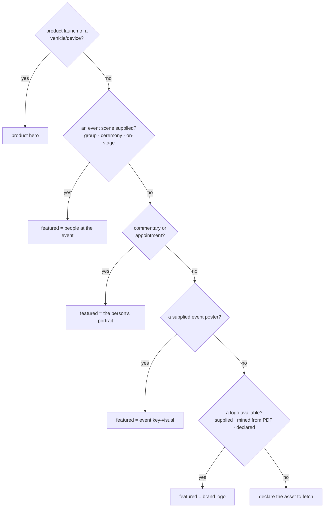

# msme-image-select — human guide (v4, 2026-10-23)

*The readable companion to the machine skill at `.claude/skills/msme-image-select/SKILL.md`.
The SKILL.md is self-contained for handover; this guide says in human terms what the skill does, what
changed and why. Every edit is logged in `CHANGELOG.md` beside it (MG's audit rule, 2026-10-23).
Scoring rulebook: `pipeline/IMAGE_GUIDE.md`. Code: `pipeline/imgselect.py`.*

## What it does

For one article it chooses the **featured image** and 0–6 **in-body images**, renames them to MSME's
convention, writes one factual caption per used image, and — when the folder holds nothing usable —
**declares which asset to fetch** instead of guessing. Calibrated against **30 raw→published pairs**
whose published image was traced back to the released files by pixels (`analysis/imageeval/`).

**Current score:** rung 90.0% · asset 83.3% · rename 100% · in-body 100% · **overall match 80.0%**
(measured by `python tools\imgeval.py`).

## The two changes that matter

### 1. It looks at the pictures

v3 worked from filenames, and that is exactly how the 2026-10-23 live run claimed the people rung for
`1.jpg`. v4 reads every candidate with a vision model (`pipeline/vision.py`): kind of visual, how many
people, whether text dominates, and a plain description of the frame. Captions are written from that
description plus the release, so they describe the picture that is actually there.

### 2. The release's attachments are part of the release

The receive stage only collected loose `*.jpg/*.png`. But MSME puts pictures **inside the attachment**.
Mining the supplied `.pdf`/`.docx` (`pipeline/harvest.py`) recovered the featured asset for a third of
the corpus:

| case | where TARGET's picture came from |
|---|---|
| ACCCIM ×2, SME Malaysia, MICSEA, PIKOM, Sun Life, Securities Commission | the **PDF header** — the published logo is a literal crop of it |
| TP-Link | `word/media/image2.png` inside the `.docx` |
| CAEXPO | a supplied `.heif` (needs a HEIF codec, not a rename) |

## The ladder (v4) — gated by story type

Measured distribution of the 30 published featured images: **people 14 · logo 12 · event-visual 2 ·
product 1 · none 1**.

### Why "story type" and not a flat ladder

Two published articles break a flat people-first chain, both verified from pixels:

- **MICSEA** and **Sun Life (Legacy Planning)** supplied a spokesperson portrait and TARGET published
  the **organisation logo**. In a statement or survey the organisation is the subject; the portrait is
  a quotee.
- **Tealive** and **Wagyu** supplied food/drink imagery; TARGET published **people**, not the product.
  The only product-hero featured image in the corpus is a **car**.

So the rule is: read the story first, then apply the rung that fits it.

## In-body images

0–6, and **0 is normal** — 25 of 30 published articles ran featured-only. In-body images appear when the
folder supplies several strong photographs of a photo-rich event (measured: Tealive 2, CAEXPO 4,
Wagyu 6, MYHK 1, Mercedes 6). Never a second frame of the featured's principal; never junk or a
duplicate.

## Rename & caption

- Rename: `<Subject>_<Month>_<Year>_MALAYSIA-SME.ext`, then `…-2`, `…-3`; no spaces. The site's own
  casing varies, but all 22 file-based decisions in the corpus fit this pattern.
- Caption: **one factual sentence**, supplied facts only, stored with the image (the site renders
  `alt=""` and no caption — store it anyway). No editorial notes; uncertainty goes to `Flags`.
- **Graph images are never the key visual (D-008):** a chart may sit in-body only.

## HOLD, and the asset it must name

No usable visual → the article does not publish, and the skill must output
`asset { kind, subject, fetch: true }` naming the brand/person/event — e.g. `logo "MICSEA"`,
`people "author portrait"`, `event-visual "MIHAS"`. Naming is not fetching: the file must be on disk
before build (`FEATURED_EXISTS`, T-018). Generated images stay out until MSME answers **T-004**.

## Residual mismatches (honest list)

Of the 30 articles, six do not match, and `pipeline/IMAGE_GUIDE.md` §5 classifies each:

- **AFFIN commentary** — TARGET published *no* featured image. Unwinnable by construction.
- **TP-Link** — the skill picked the same MoU event, a different frame, from the `.docx`. Correct
  behaviour, scored fail because it is not the identical file.
- **MYHK** — two photographs of one ceremony; the skill took the landscape, TARGET the portrait. A
  coin flip.
- **MICSEA / MIHAS** — the issuer's name vs the event's name. Fixable with a brand alias table (T-019).

## Maintenance

- **Every SKILL.md edit: log it in `CHANGELOG.md` and update THIS guide** (MG, 2026-10-23).
- Re-measure with `python tools\imgeval.py --detail` after any rule change; change one rule at a time.
- New evidence: `tools\imgtruth.py` → `tools\imgtag.py` → `tools\imgdata.py` → `tools\imgeval.py`.
- The engine's dev suite (`pipeline\GUIDE.md`) re-checks the rendered result and flags drafts made by an
  older skill version.
- Pilots that prove this skill: T-002, the T-005 re-pilot, the T-008 re-check, the live engine runs of
  2026-10-23, and the v4 calibration of 2026-10-23 (30 pairs).
