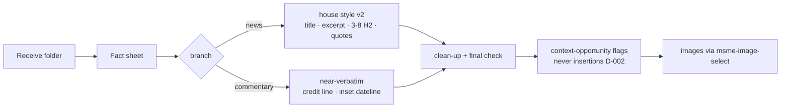

# msme-repurpose — human guide (v3.1, 2026-10-26)

*The readable companion to the machine skill at `.claude/skills/msme-repurpose/SKILL.md`.
The SKILL.md is self-contained for handover; this guide says in human terms what the skill does, what
changed and why. Every edit is logged in `CHANGELOG.md` beside it (MG's audit rule, 2026-10-23).*

## What it does

Takes one accepted raw press release (the Receive-stage folder) and produces one upload-ready
MALAYSIA SME article: rewritten title, dateline excerpt, opening, 3–8 factual subheaders, compressed
quotes, clean-up, final check — plus image selection via the `msme-image-select` skill.

## Why v2 — what the site actually publishes

The Sept-2026 docx prescribes one flow; the live site diverges in stable, measurable ways
(corpus/METRICS.md; REPURPOSE_COMPARISON.md was the 17-pair first study):

- **Subheaders 3–8** (median 5) — the docx says 3–4.
- **Quote compression** — blockquote a **selected subset** of the strongest quotes, each ending at a
  sentence boundary; the rest is reported speech; 0 blockquotes is fine when nothing earns one
  (median 2 · max 6; a long quote may give its complete first sentence, C-006).
- **Excerpt 25–42 words**, one sentence, five dateline forms.
- **Neutral wrap-up**; release boilerplate may reappear as an "About" closing section.
- **Bylined pieces keep the byline** (first person removed); **captions stored, not displayed**;
  **1–4 categories** (never PILLARS/COLUMN); mechanical clean-up (CAPS dates, ` - ` dash).
- **Commentary branch (decided: class trigger, R2 — 2026-10-16; front-matter refined 2026-10-19,
  T-008)** — the statement/commentary class (org statements/responses on a policy or decision, signed
  or not) is published near-verbatim (reuse 95–98%). The **body** is reposted; the **front-matter is
  editor-normalised** (C-018/C-019/C-023/C-026/C-028): a clean org title is kept (`<Org> Commentary
  on <Topic>`), a person/reaction headline becomes `<Org> Commentary on <Topic>` with the person moved
  to the credit line; a supplied subtitle is kept as a deck; a body dateline becomes an inset (a
  separate meta line is dropped); a generic opening welcome may be trimmed; the credit line is
  **only when supplied** ("Kindly attribute to:" → "By"); no excerpt/subheaders/quotes; one topic
  category. The three 30 Sep–2 Oct statement pairs (C-003, C-013, C-015), published news-format by
  another account, are the **recorded deviation** — not targets. Signed opinion/byline pieces (row 3)
  stay news-byline pending MSME confirm-item 2.

## What changed on 2026-10-25 — the commentary branch needs a self-description

Rule 2 now requires the release to **describe itself as opinion** (`opinion`, `commentary`, `column`,
`viewpoint`, `perspective`, `for your reader`) *on top of* being a statement or response on a policy or
decision. A statement alone is common in house-style news; the self-description is what separates the
near-verbatim treatment from a normal rewrite.

Measured basis: 8 corpus releases are policy statements, but only 5 were republished near-verbatim. The
other 3 came back at 12 %, 28 % and 41 % body reuse — the old trigger over-selected. `By <name>` is not a
substitute: it appears in 20 of 22 house-style releases. On the 20 fresh releases the tightened rule still
fires 2/20 where the publisher rewrote all 20, so it is better, not exact. Full numbers:
`CHANGELOG.md` (2026-10-25) and `tools\repurpose_eval.py`.

## The contested rules and where they live

| question | rule | where |
|---|---|---|
| may the AI add facts not in the release? | **Never.** Emit "context opportunity" flags (what to add, from which source class, where) | D-002 + `analysis/repurpose/EXTERNAL_FACTS_PLAYBOOK.md` |
| no image supplied? | Use a **related logo/banner** (media kit → supplied logos → MSME library); HOLD only with nothing related | D-003 |
| docx vs live site? | Live practice governs, per the v2 list above | D-004 |
| which releases take the commentary branch? | The statement/commentary class (row 4, signed or not; R2); byline pieces (row 3) pending MSME; C-003/C-013/C-015 are the recorded deviation | D-004 + `analysis/repurpose/ARTICLE_TYPES_AND_GATES.md` |
| how many quotes are blockquoted? | A selected subset, each at a sentence boundary; the rest reported; 0–6 (median 2) | D-004 + `corpus/METRICS.md` |
| may a source line be added? | Only if verifiable from the receive folder / `link.md`; otherwise flag it. Attribution-only lines are not external facts | D-002 + `analysis/repurpose/EXTERNAL_FACTS_PLAYBOOK.md` |

## The fact sheet discipline

Every sentence written must trace to a fact-sheet row (who/what/when/where/why, numbers, verbatim
quotes). Unattributed superlatives ("leading", "No. 1") stay only if supplied — otherwise `[FLAG]`.
This is what makes the final check falsifiable.

## Added 2026-10-23 (from the first live engine runs)

| rule | what it says | why it exists (measured) |
|---|---|---|
| **6 — categories reuse the site vocabulary** | use category names the site already uses (automotive · business · government · technology · sme · financing · awards · events-happenings · news); invent a short slug only when none fits | the live model invented `aftersales-and-warranty`, `vehicle-financing` where the cold drafts used the site's words |
| **7 — every section says something new** | never repeat a paragraph, sentence or heading; merge or drop instead | one live draft repeated a whole section three times |

The engine enforces both mechanically (`DUPLICATE_SUBHEADER`, `REPEATED_PARAGRAPH`) and fails a draft
that breaks them, so the model gets one retry with the failure list rather than publishing a repeat.

## Maintenance — every skill edit updates three files

1. `SKILL.md` — the rule itself;
2. `CHANGELOG.md` — date · what · why (evidence);
3. `GUIDE.md` (this file) — what the skill now does in human terms.

Then run the engine's checks: `python -m unittest discover pipeline\tests` (which rule moved) and
`python -m pipeline.devtests` (links, drafts, skill staleness, dashboard, snapshots).

## Worked example (Wagyu, C-004)

Raw: `KUALA LUMPUR, 30 SEPTEMBER 2026 — As Japanese Wagyu continues to gain traction… "Japanese
Wagyu is something that more people in Malaysia are becoming familiar with…" said Mr. Koichi
Takano, Managing Director of JETRO Kuala Lumpur.` (6 more paragraphs, links, About sections.)

Out: title `Japanese Wagyu's Growing Malaysian Trade Puts Secondary Cuts in the Spotlight`; excerpt
`KUALA LUMPUR, 30 SEPTEMBER 2026 - JETRO Kuala Lumpur, Zenrich Wagyu and the Kurohana Wagyu Export
Promotion Consortium bring Malaysian F&B professionals together to explore secondary cuts,
whole-carcass utilisation and new menu opportunities.`; 6 H2s; one blockquote holding the quote's
first two sentences; links/contacts/About removed; categories (4 — recorded).

## Failure modes → EDITOR REVIEW

Ambiguity · misleading claims · legal/reputational content · political/advocacy · bylined material ·
unclear commercial intent · insufficient material · no usable image at all (HOLD).

## Evidence, tests and maintenance

- Corpus: `corpus/` — 30 pairs; add new samples as `corpus/C-<nnn>.md`, then
  `python tools\build_corpus.py`.
- Candidate detection: `python tools\corpus_digest.py` → `analysis/repurpose/digests/`.
- The pilots that prove this skill: **T-002** (C-016 + C-015 through SKILL.md, diffed vs published), the
  **T-005** re-pilot (C-016 news regression · C-019 commentary + D-003 logo · C-015 trigger under R2),
  and the **T-008** re-check (C-006 · C-007 news quote selection; C-018 · C-023 commentary front-matter).
