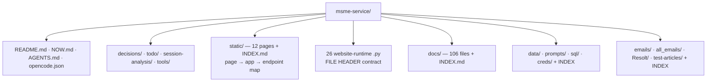
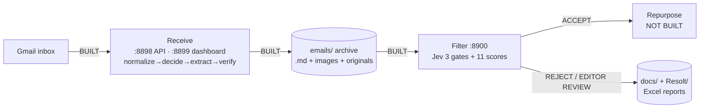

# msme-service — T2 setup + website `.py` headers

**Session:** 2026-10-21_S01 · **Turn:** 1 · **Decisions/items:** D1–D4 · T-001–T-008
**Raw reply for the user.** Chat carries the summary only.

---

## 1. Project structure created — and why

The folder already had a strong runtime but no workflow home: a 95-line architecture README, 7,140 lines
of Python, 12 HTML pages and 106 mixed `docs/` files (113 after the moves), with no register, rule file or reply convention.
T2 was chosen because this is a long-running, multi-stage, multi-test coding project.



| Created / changed | Why |
|---|---|
| `README.md` → new 56-line map | one place that says where everything lives; old text preserved as `docs/ARCHITECTURE.md` |
| `NOW.md` (28) · `AGENTS.md` (15) · `.claude/rules/msme-service.md` (16) | standing state + session rules, injected every turn |
| `opencode.json` | loads only `NOW.md` + the rule file; permissions: reads/edits allowed, `git commit/push` and `rm` denied |
| `decisions/` D1–D4 + generated INDEX | the single home for decisions |
| `todo/` T-001–T-008 + generated INDEX | the single home for open/parked work |
| `tools/build_register_indexes.py` | copied verbatim (sha256 identical to the workflow source) |
| `INDEX.md` in `static/ docs/ data/ prompts/ sql/ creds/ test-articles/ emails/ all_emails/ Resolt/` | every content folder now says what it is |
| `session-analysis/2026-10-21_S01_project-setup/` | this reply |

**Files moved (no code path referenced them — checked):** root analysis `.md` files → `docs/` (2 cross-links
updated); root `FILTER-REPORT*.xlsx` + `weekly.xlsx` → `Resolt/`; 6 Google OAuth **client-secret** JSONs →
`creds/`; stale `.~lock.*` files deleted.

**Probe (run this session):**

```
JSON_OK ['NOW.md', '.claude/rules/msme-service.md']
OK: decisions=4 {'decided': 4}; todo=8 {'open': 4, 'parked': 4}; live=4
python3 -m compileall -q <26 modules>      -> COMPILE_OK
python3 -c "import main, dashboard, filter_service, pipeline" -> IMPORT_OK
8898 /health  -> {"status":"ok","auto":false,"schedule_minutes":5}
8899 /api/health -> {"status":"ok","auto":false,"schedule_minutes":5}
8900 /health  -> {"status":"ok","service":"filter","model":"jev-latest"}
git status: 202 source/docs files untracked; creds/*.json, data/, emails/, all_emails/, Resolt/ ignored
```

⭐ **Decision — §1:** ✅ nothing to decide (the tier and README reconciliation were your choices; executed as approved).

---

## 2. Current status — what is built and what is ongoing



- **Receive** is live: 14-column checklist to Google Sheet + SQLite, local archive, three AI steps, auto-poll
  available but off. Health endpoints answered on 8898/8899 during this session.
- **Filter** is live on :8900: Jev answers a battery of **3 hard gates + 11 weighted scores** in one call;
  code routes ACCEPT / REJECT / EDITOR REVIEW; gate definitions and wording are tunable via the Lab and
  Config pages; report runs write Excel/CSV/TSV into `docs/`.
- **Repurpose does not exist as code or page** — only a next-week action in `docs/AI-NEWS-WEEKLY-5-13-OCT.md`.
  That is `todo/T-001`.
- **Ongoing work visible in the files:** filter tuning (`gates-def-*` variants, latest 19 Oct), image/logo
  detection accuracy, and report-value verification. The weekly report's own numbers: 66 emails received,
  20 editor rejects, 7 AI rejects (%R 48.1%), %A 12.4%; text located 52/55 (94.5%), images lower.
- **Git:** repo initialised this session; **nothing committed** (201 files staged as untracked only).

⭐ **Decision — §2:** ✅ nothing to decide.

---

## 3. `.py` header comments — delivered

26 website-runtime modules now start with a contract block, then keep their original docstring:

```python
# =============================================================================
# FILE HEADER
# file    : filter_service.py
# role    : Filter — FastAPI app on :8900
# owner   : Hisham (human owner) · AI coding sessions may amend under his review
# purpose : serve the filter/lab/testfilter/report pages and the verdict dashboard; ...
# pages   : filter, verdicts, workflow, logs, config, lab, testfilter, report
# calls   : filter.judge, docs/*.xlsx|json, data/filter_verdicts.jsonl, settings_store (lazy)
# called  : uvicorn `filter_service:app` from run.py; the browser pages
# amend   : report paths are hard-coded to docs/ (decisions/D4); page routes must match static/INDEX.md.
#           Test: curl -s localhost:8900/health and GET /filters.json
# =============================================================================
"""Filter service on :8900 — the Jev Stage-1 editorial judge.
```

Covered: `run, main, dashboard, scheduler, pipeline, config, settings_store, db, checklist,
connection_test, creds, gmail, normalize, decide, extract, verify, drive_fetch, archive, reply, llm,
deepseek, box_fetch, filter, filter_llm, prefilter, filter_service`. They compile and import after the
insertion. Ops/test scripts remain without it by your scope choice (`todo/T-003`).

⭐ **Decision — §3:** ✅ nothing to decide.

---

## 4. Two measured findings that change what the docs may claim

1. **Battery mismatch.** Live `GET localhost:8900/filters.json` → **3 gates, 11 scores, 0 extra, weights
   sum 100**. `docs/ARCHITECTURE.md` and `docs/FILTER-LOGIC.md` still describe an older **6 gates + 8
   scores** battery, and `filter.py`'s own comment says the weights sum to **96** (they sum to 100).
   Tracked as `todo/T-002`; no code change yet.
2. **Receive accuracy.** The weekly report already disproves "100% text + image":
   text 52/55 (94.5%), `hasPic` 20/55, `hasImageInArticle` 36/55, `hasLogoInArticle` 30/55.
   Tracked as `todo/T-008`.

⭐ **Decision — §4:** ✅ nothing to decide (both are doc/diagnosis work, not choices).

---

## 5. ⭐ Decision — rotate the exposed OAuth client secrets?

**What it means operationally.** Six Google OAuth client-secret files sat in the project root, readable by
anyone with folder access and outside the old `.gitignore`; they are now in `creds/` and ignored. Measured
client IDs: `279187771445-oicp…` (used by **live** `gmail.json`, `drive.json`, `sheets.json`!) and three
others (`936991497155-qrn1…`, `…-ppbnma…`, `…-4c855…`) used by nothing.

Real example: if the folder was ever copied or shared, the holder can impersonate the OAuth client. For the
**live** client, a naive rotation also breaks token refresh because `creds/gmail|drive|sheets.json` store the
old secret — so rotation must be coordinated: reset secret → update those three files → restart.

**Options.** (A) Rotate the 3 unused clients now, and schedule the live client's rotation with a creds update
and restart *(recommended)*. (B) Rotate the live client too, immediately. (C) Ignore — accept local exposure.

**Measured effect of NOT deciding:** the secrets stay valid indefinitely; the risk becomes real the moment
the folder is copied, zipped or pushed. Nothing in the current build breaks either way.

**Blocks:** nothing. **Needed by:** before the first push/share of this folder.
**Register:** `decisions/D3.md` (rule) · `creds/INDEX.md` (inventory).

⭐ **Decision — §5:** rotate now in two phases (A) · rotate everything immediately (B) · ignore (C)?

---

## 6. ⭐ Decision — make the first git commit?

The repo is initialised and correctly excludes `creds/`, `data/`, `emails/`, `all_emails/`, `Resolt/`.
202 source/docs/register files are untracked; **no commit was made** (your rule: only on request).

**Effect of deciding now:** a clean baseline you can diff future work against. **Effect of waiting:** no
loss; every later change shows up mixed with this setup in the first diff. **Blocks:** nothing.

⭐ **Decision — §6:** commit the baseline now, or leave it uncommitted?

---

## 7. Parked this turn

- `T-003` headers for the 7 ops/test scripts (scope choice).
- `T-004` split `docs/` into gate-defs / outputs / notes — code reads `docs/` flat (11 call sites).
- `T-006` duplicate FastAPI route sets in `main.py` and `dashboard.py`.
- `T-007` two archive stores, `emails/` + `all_emails/` (2.8 GB).
- `T-005` independent recomputation of one published report's values (open, not parked).
- `T-001` repurpose stage (open — next real build).
- `T-008` receive accuracy (open — image detection is the weak side).

---

## Recap

| # | Item | State | Owner |
|---|---|---|---|
| 1 | T2 structure + indexes + registers | done, probed | — |
| 2 | Status: receive ✅ · filter ✅ · repurpose ❌ | measured | — |
| 3 | 26 `.py` headers (owner/purpose/calls/amend) | done, compiles | — |
| 4 | Battery + accuracy contradictions | recorded | T-002 / T-008 |
| 5 | Six OAuth client secrets moved | **rotation open** | **you** |
| 6 | Git baseline | **uncommitted** | **you** |

## What I recommend next

**Start a NEW session** (this one is setup-heavy) with **medium** thinking effort: fix `T-002`'s doc/battery
mismatch and diagnose `T-008`'s image misses — both are code-vs-measurement work that benefits from a clean
context. Answer §5 and §6 first (`secrets = A|B|C`, `commit = yes|no`) so the session can act on them.

Ready-to-paste prompt:

> Read `README.md`, `NOW.md`, `todo/INDEX.md` and today's reply. Work `T-002` (reconcile docs + the SCORES
> comment with live `/filters.json`) and `T-008` (diagnose why image detection is below 100%). Verify by
> running the service, not by re-reading docs. Reply in `session-analysis/` per the project rules.
