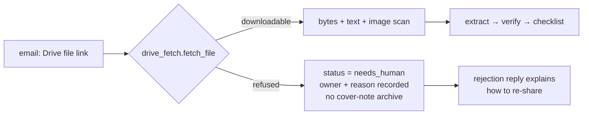

# MSIA Budget 2027 — why "no article", fixed and deployed

**Session:** 2026-10-22_S02 · **Turn:** 2 · **IDs:** D6 · T-010 · T-011

---

## 1. Why it said "no article found"

Measured on run `03f82fa1-…` (email `1a1096dc8c3e8df1`):

| Check | Result |
|---|---|
| Attachments | 0 |
| Decider's link | `drive.google.com/file/d/1xu00…/view` (a **file**, not a folder) |
| Pipeline guard | only matched `/folders/` → the file link was ignored |
| Extract | `bodyTextLen: 0`; "PDF exists only as a Google Drive link that was not fetched" |
| Drive metadata | `MSIA Malaysia Budget 2027 - Final.pdf` · 36,896,175 bytes · owner `dayana.arif@msia.org.my` |
| Drive permission | `canDownload: false`, `canCopy: false`; a media request returns **403 `cannotDownloadFile`** |
| Run status | `success` (wrong) and a 4.5 KB cover note was archived |
| Google Sheet | row written with `hasArticle=false`, `readyToFilter=false` |

So there were two defects: the code did not understand a Drive **file** link, and this particular PDF is
shared view-only, so even correct code cannot download it.

⭐ **Decision — §1:** ✅ nothing to decide.

---

## 2. What was built, tested and deployed

| Change | Effect |
|---|---|
| `drive_fetch.file_id_from_link()` + `fetch_file()` | understands `/file/d/<id>` and `?id=`; typed result or refusal |
| `pipeline.py` `drive_file_fetch` branch | merges the fetched PDF into the normal extract/logo/archive path |
| `needs_human` status | `main.py`, `dashboard.py`, `checklist.html`; Logs/Flow show "needs human", not "completed" |
| no archive on refusal | the cover note can no longer be saved as an article |
| one run row per request | `process_email(..., run_id=)` reuses the caller's row (was creating a duplicate) |
| extract text cap | `EXTRACT_MAX_CHARS=120000` so a 37 MB PDF cannot overflow the AI prompt |
| reply reason | the apology now names the view-only Drive file and how to re-share |
| deployment | rebuilt image `msme-service:fix-20261021`, container recreated with the same mounts; `docker-compose.yml` aligned to the live bind mounts; health OK on 8898/8899/8900 |

**Measured proof after the fix**

- `fetch_file(1xu00…)` → `ok=false`, `cannotDownloadFile`, owner `dayana.arif@msia.org.my`.
- `fetch_file(198OsZ…)` (a downloadable test PDF) → `ok=true`, 10,712 chars extracted.
- Folder walk regression → docs 1, images 4, unchanged.
- **Live re-run** of the MSIA email (`3734109b-…`) → status **`needs_human`**, `articleFile=""`,
  archive `skipped`, checklist `hasArticle=false`; no reply sent (`REPLY_ENABLED=false`).
- The two bogus cover-note folders (`emails/…`, `all_emails/…`) were deleted.

⭐ **Decision — §2:** ✅ nothing to decide.

---

## 3. What only you can do — ask MSIA to enable download

The file's owner has disabled download; no code or account change on our side can fetch it. Send
`dayana.arif@msia.org.my` this, or forward it:

> Your Google Drive PDF (`MSIA Malaysia Budget 2027 - Final.pdf`) is view-only — our system cannot
> download it. Please share it with download enabled (Share → Viewer → allow download), or share it with
> `ainews.msme@gmail.com`, or send a PDF under 25 MB.

When it is re-shared, press **Run** on the same email; no code change is needed. Expect `hasArticle=true`
and the PDF saved in the article's `originals/`.

**Effect of not sending it:** this release stays unfilterable and the weekly report counts it as missing.

⭐ **Decision — §3:** send the message now (A) · you will handle it later (B)?

---

## 4. Still in your queue (unchanged, not repeated here)

- **D3** — rotate the six OAuth client secrets moved into `creds/`, and say whether to make the first commit.
- **T-009** — build the filter-variant map (A) or leave it parked (B).
- **T-001** — repurpose stage, the next real build.

---

## Recap

| # | Item | State |
|---|---|---|
| 1 | MSIA file: file-link support + refusal reason | **fixed, deployed, verified live** |
| 2 | `needs_human` instead of `success`; no bogus archive | **done** |
| 3 | MSIA re-share request | **awaiting you** (T-011) |
| 4 | Compose now matches the live container | done |

## What I recommend next

Send the T-011 message now, then start a **new session at medium effort** on **T-001 (repurpose)** —
it is the only unbuilt stage and needs a short design decision on the output format before code.

> Ready-to-paste prompt: Read `README.md`, `NOW.md`, `todo/INDEX.md` and today's replies. Start `T-001`:
> propose the repurpose output (format + inputs from an ACCEPTed article), ask me one decision, then build.
