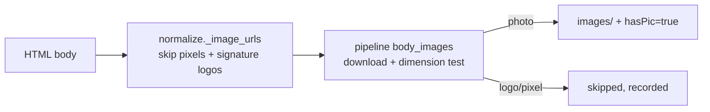

# IRGCE 2026 — body photos now count as hasPic

**Session:** 2026-10-22_S02 · **Turn:** 3 · **IDs:** D7 · T-012 · T-013 · T-014 · T-015

---

## 1. Why it said "no pic"

| Evidence | Measured |
|---|---|
| Attachments | **0** — the email has only `text/plain` + `text/html` |
| The pictures | **5 remote `` URLs** on `imagedelivery.net`, inside the HTML body |
| The files | JPEG **640×427**, 29–59 KB each — real photos, not tracking pixels |
| `normalize.py` | collected only `<a href>` links; `` was never read |
| Pipeline | counted pictures only from downloaded files ≥ **1 MB**, so these web-sized photos could never qualify |
| Result | `hasArticle=true`, `hasPic=false`, `readyToFilter=false` |

The other `MARGMAs IRGCE…` folder with 16 JPGs is from a different email that had real attachments — not
this forwarded message.

⭐ **Decision — §1:** ✅ nothing to decide.

---

## 2. What was built, verified live, and deployed

| Change | Effect |
|---|---|
| `normalize.bodyImageUrls` | reads ``, skips tracking pixels, `mail-sig`/signature URLs and images declared ≤150×60 in the tag |
| `pipeline` `body_images` stage | downloads up to 12, cap 8 MB, keeps **photos** (`max ≥ 500 px`, `min > 150 px`, ≥10 KB) |
| `hasPic` | now includes body photos; files are saved under `images/` and passed to verify |
| signature guard | MSIA's 879×392 signature file (displayed 96×41) is correctly skipped, so no false `hasPic` |
| **T-014 fix** | the Filter ready-list now indexes `emails/` **and** `all_emails/` — **71/71** ready rows resolve, was 17/71 |

**Live proof**

- IRGCE re-run `603d5207-…` → `hasPic=true`, `hasImageInArticle=true`, `readyToFilter=true`,
  **subjectScore 99**; 5 files `bodyphoto-1..5.jpg` (29–59 KB) saved in `images/`.
- `/archived` now returns a real path for it and `/archived/read` returns the 4,669-char article.
- MSIA email re-checked: body image URLs reduce to one 16×16 icon (skipped) — no false picture.
- Deployed as `msme-service:body-images-2-20261022`; `:8898` and `:8900` health OK.
- `python3 -m compileall -q *.py` and imports OK.

⭐ **Decision — §2:** ✅ nothing to decide.

---

## 3. Parked / still open

- **T-013** — fetching an ordinary linked web page (the email's "full release and photos" vritimes link) —
  parked as you chose.
- **T-015** — the Jev **report runner** still scans only `emails/`; 54 of 71 articles live in `all_emails/`.
  Parked (the ready-list path is fixed; report runs are separate).
- **T-011** — MSIA still needs the re-share message you are sending.
- **D3** — secret rotation + first commit still unanswered.

⭐ **Decision — §3:** ✅ nothing new to decide.

---

## Recap

| # | Item | State |
|---|---|---|
| 1 | Inline body photos counted as `hasPic` | **done, live, verified** |
| 2 | Signature-logo false positives | guarded |
| 3 | Filter ready-list across both archive roots | **71/71 resolve** |
| 4 | Report runner root split | parked (`T-015`) |
| 5 | MSIA re-share | awaiting you (`T-011`) |

## What I recommend next

Start a **new session at medium effort** on **T-001 (repurpose)** — the only unbuilt stage; it needs one
short decision on the output format before code. Send the T-011 message in parallel.

> Ready-to-paste prompt: Read `README.md`, `NOW.md`, `todo/INDEX.md` and today's replies. Start `T-001`:
> propose the repurpose output (format + inputs from an ACCEPTed article), ask me one decision, then build.
