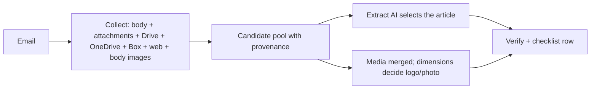

# Finnfund was not “no image” — the collect order was wrong

**Session:** 2026-10-23_S03 · **Turn:** 1 · **Image:** `msme-service:collect-select-20261023`
**IDs:** D24 · T-036

---

## 1. Why Finnfund said “no image or logo”

The email (`1a0efb123aeb2679`) **does** contain images; the pipeline rejected them before looking at them.

| `` in the HTML body | Bytes | Dimensions | Old result |
|---|--:|---|---|
| Finnfund newsroom logo | 8,662 | **250×87** | `too_small` |
| EVF thumbnail | 2,259 | 100×55 | `too_small` |
| SendGrid tracker | — | 1×1 | dropped (correct) |

`BODY_IMAGE_MIN_BYTES=10000` ran **before** dimension classification, so the real 250×87 logo never
reached `_kind_from_bytes`. The run stage recorded exactly that: `body_images.status=empty`, both URLs
`reason=too_small`.

The linked Cision release page also has a real **800×440 photo (39,394 B, classifies `photo`)** plus the
logo. The web fallback never ran: the body is a complete release (5,751 chars > 2,500) and
`is_article_url()` did not recognise `news.cision.com/…/r/…`.

Net effect: `hasArticle=true`, subject 100, `hasPic/hasLogo=false` → not ready. The flags were “correct”
for the rules, but the rules collected in the wrong order.

⭐ **Decision — §1:** ✅ nothing to decide — this was a measured bug.

---

## 2. What was built (D24)

**Collect first, then select.** Every run now gathers:

- every attachment text (all PDFs/DOCX, not only the decide-chosen one) and every embedded image;
- the linked Drive folder/file/Google Doc, OneDrive share and Box kit (first eligible link per
  provider; every document inside a kit);
- every article-like web page, up to 3 (Cision `/r/…` newsrooms included);
- remote HTML-body images and direct asset links.

Those texts form one candidate pool with provenance `{source, name, url, text}`. The extract AI sees the
email body plus the top ranked candidates and returns `chosenCandidate`; `articleSource` follows that
choice. Deterministic ranking only orders the pool (release markers, subject overlap, source trust,
length) — it does not decide the article.

Also fixed:

- body media is classified by **dimensions**; `BODY_IMAGE_MIN_BYTES` is now a 512-byte sanity floor,
  not a 10 KB media gate;
- a failed attachment download no longer aborts the run (per-file guard);
- a refused Drive/Box source no longer forces `needs_human` when another source supplies the article;
- the decide AI’s link is followed only when `normalize` also saw it in the email (link-guard);
- web media is fetched even when the body already contains the article — this is what found the Finnfund
  photo.

⭐ **Decision — §2:** ✅ nothing to decide — the requested workflow is now the code path.

---

## 3. Verified live

**Finnfund** — run `e80724f3-…`, checklist row **368**:

| article | pic | logo | image-in-article | subject | ready |
|:--:|:--:|:--:|:--:|:--:|:--:|
| ✅ | ✅ | ✅ | ✅ | 100 | ✅ |

Stages: body logo `bodylogo-1.png`; web fetch 1 URL → 4,372 chars + `webphoto-4.jpg` (800×440);
1 candidate presented to the AI; chosen `C1` (`web_link`); 6 images archived.

**Regression sample** (new runs):

| Email | Row | Ready | Note |
|---|--:|:--:|---|
| i-City | 369 | ✅ | Drive folder, subject 98 |
| Anak Sulung | 370 | ❌ | still no media (expected) |
| Malaysia’s exports | 371 | ✅ | subject 100 (was 94) |

**Totals:** 149 emails · **132 ready** · **17 not ready** · **11 asks**. Health: API :8898 ok, filter
:8900 ok, container healthy.

⭐ **Decision — §3:** ✅ nothing to decide.

---

## 4. Records updated

- `decisions/D24.md` + `todo/✅ T-036.md`; indexes regenerated (24 decisions, 36 todo items).
- `docs/NOT-READY-TO-FILTER-2026-10-22.md` → **17 remaining** (Finnfund removed; 132/17).
- `docs/SENDER-ASKS-2026-10-22.md` → **11 asks** (Finnfund removed).
- `NOW.md` → D24 + new totals.
- Unit tests: `python3 -m unittest tools.test_collect_select -v` → **11 pass**.
- New session folder S03 follows the day-folder rule; the D23 turn still has no numbered reply file and
  replies 28–31 were written on 23 Oct inside the 22 Oct folder (structural drift, no data lost).

⭐ **Decision — §4:** ✅ nothing to decide.

---

## 5. What comes next

The receive stage now collects and selects as requested. The only unbuilt stage remains **Repurpose**
(`T-001`); `T-024`/D14 (attached photos by dimensions) is still deferred; `T-005` (verify one published
report’s values) is still open.

| Option | What it means | Cost | Effect of not deciding |
|---|---|---|---|
| **A — T-001 Repurpose (recommended)** | Build the page/service that turns an ACCEPTed article into publishable output | Medium; new page + route + editorial rule | The pipeline ends at “ready to filter”; no publishable output |
| B — T-024 / D14 | Count attached photos by dimensions (<1 MB) | Small; one classifier rule + re-run | Some attached-photo articles stay `hasPic=false` (APAC is already ready via OneDrive) |
| C — T-005 | Recompute one filter report’s values independently | Small; read-only analysis | Report figures stay unverified |

**Repurpose is not blocked by this turn**; choose before the next build session. Operational owe stays:
send the **11 asks** + the MSIA re-share (`T-011`).

⭐ **Decision — §5:** next build = **A** (recommended) · **B** · **C**?

---

## Recap

| # | Item | State |
|---|---|---|
| 1 | Finnfund image/logo | **found and counted** (body logo + Cision photo) |
| 2 | Collect-then-select workflow | **built, live** (`collect-select-20261023`) |
| 3 | Byte floor | 10,000 → **512**; dimensions decide |
| 4 | Tests | 11 unit tests + 4 live runs |
| 5 | Totals | **149 · 132 ready · 17 not · 11 asks** |
| 6 | Next build | **T-001 Repurpose** (decision pending) |

## What I recommend next

Start a **new session** for T-001 Repurpose (medium effort) — it is a separate stage and should not
ride on the receive session. Paste:

> Read `README.md`, `NOW.md`, `todo/✅ T-001.md`, `decisions/D1.md`, `decisions/D2.md`. Plan the Repurpose
> stage (accepted-article source, output format, editorial rule, page + route + test) and stop for my OK
> before building.

If you prefer to close the media gap first, stay in this session and say **“do B”** (T-024/D14, small
effort).
