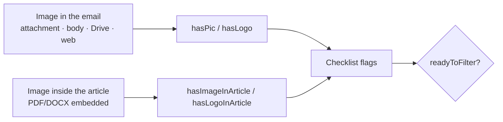

# Workflow diagram + media detail — email vs article, logo vs photo

**Session:** 2026-10-23_S03 · **Turn:** 7 · **IDs:** T-039
**Page:** `http://localhost:8899/workflow-lab.html#chart`

---

## 1. What changed

- The “Simple chart” tab is now a real **Workflow diagram** (same URL, `#chart`):
  - **Two decision diamonds**: *Where is the article?* → attachment / Drive·OneDrive·Box / web page /
    email body; *Ready to filter?* → Ready / Not ready.
  - Branches merge into **Collect candidates**, then the AI and deterministic stages, then **Save**.
  - Colour-coded nodes: purple = AI, teal = deterministic, amber = decision/output.
  - Control stays in a **scrollable diagram viewport**, so Play/Pause and the explanation card remain
    visible while the diagram auto-scrolls to the active node.
- **Media detail** added in two places:
  1. A **“Where is the image?” callout** next to *Check media*:
     **in the email** → `hasPic` / `hasLogo`; **inside the article PDF/DOCX** →
     `hasImageInArticle` / `hasLogoInArticle`.
  2. A **four-flag media map** card under the diagram, plus the **logo-vs-photo** dimension rule.
- The *Check media* stage metadata (walkthrough + detail card) now lists the four flags and where each
  one comes from.

⭐ **Decision — §1:** ✅ nothing to decide — built as asked.

---

## 2. The media rules, explicitly

| Where the image lives | What it becomes |
|---|---|
| Attached to the email (photo file) | `hasPic` |
| Attached logo file | `hasLogo` |
| Image in the email HTML body / direct asset link | `hasPic` / `hasLogo` |
| Drive / OneDrive / Box media kit | `hasPic` / `hasLogo` |
| Public web page | `hasPic` / `hasLogo` |
| **Embedded inside the article PDF/DOCX — photo** | `hasImageInArticle` |
| **Header / embedded logo in the article PDF/DOCX** | `hasLogoInArticle` |

**Logo or photo?** By dimensions:
- ≤ 300 px, a wide/short strip, or a repeated header/footer → **logo**
- ≥ 500 px → **photo**
- A header image in a DOCX is always a **logo**
- An image inside the article is **never** counted as `hasPic`

⭐ **Decision — §2:** ✅ nothing to decide.

---

## 3. Verified

- Browser screenshots (Playwright, 1500 px):
  - step 3: *Where is the article?* active, branch nodes visible;
  - step 7: *Check media* active, the **“Where is the image?”** callout fully visible with both rows;
  - completion: **11/11**, all nodes green, the “Two outcomes” detail and the media map visible.
- Page `GET /workflow-lab.html` → **200**; the callout and media map are in the HTML.
- No backend/pipeline change in this turn: **38 tests pass**; live DB unchanged
  (**208 checklist · 322 runs · 218 pipeline_results**).

⭐ **Decision — §3:** ✅ nothing to decide.

---

## Recap

| # | Item | State |
|---|---|---|
| 1 | Workflow diagram with two decision branches | **built + live** |
| 2 | Animated, scrollable viewport + Play/Pause/Play again/Reset | **done** |
| 3 | “Where is the image?” callout (email vs article) | **done** |
| 4 | Four media flags + logo-vs-photo rules | **done** |
| 5 | Media map card + detail card | **done** |
| 6 | Tests / no writes | **38 pass · DB unchanged** |

## What I recommend next

Open **`http://localhost:8899/workflow-lab.html#chart`**, let it play once, then click **Check media**
and read the media map. That is the full distinction between `hasPic`, `hasLogo`,
`hasImageInArticle` and `hasLogoInArticle`. The walkthrough tab still has the real code and runnable
examples.
