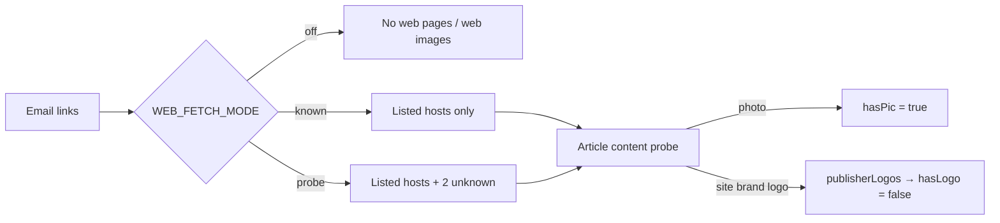

# T-043 — published-release media via a generic web probe

**Session:** 2026-10-26 · S05 · reply 1
**Status:** T-043 **done**. One decision needed before T-044.

## 1. What changed

The PitchMyStory-only fix became a **generic web article probe** (D28). It does not depend on
the sender or a per-site branch: it reads the page and decides whether the page is an article.

- `web_fetch.py` — 3-state `candidate_links`, content probe (`is_article`), SSRF guard,
  publisher-logo separation, WebP `.webp`, DNS/fetch retries for the Docker resolver.
- `pipeline.py` — reads `WEB_FETCH_MODE` fresh per email. `off` skips `web_fetch`,
  `body_images` and `asset_link`; only `ok and is_article` text/media enters the candidate
  pool; publisher logos never set `hasLogo`.
- `extract.py` — WebP dimensions (VP8 / VP8L / VP8X). `normalize.py` — `linkTexts` for
  “View the published release”.
- Config page + API — `WEB_FETCH_MODE` select and `WEB_KNOWN_SITES` textarea; an invalid
  mode becomes `probe`, an empty known list is allowed.

✅ nothing to decide — §1

## 2. Live proof — Event Me Now

Live dry-run in the container, email `1a1160f03ca04ae4`, no archive/Sheet/DB writes:

| Mode | Candidate | `hasPic` | `hasLogo` | `readyToFilter` |
|---|---|---|---|---|
| `probe` | PitchMyStory release | **true** | false | **true** (subject 100) |
| `known` | PitchMyStory release | true | false | true |
| `off` | none (skipped) | false | false | false |

The page yielded 6,594 chars and the **1536×1024 WebP** featured image
(`webphoto-1.webp`, 151,524 bytes). Four PitchMyStory brand images stayed in
`publisherLogos`. Settings were restored to `probe`.

✅ nothing to decide — §2

## 3. Config and safety

`WEB_FETCH_MODE` is editable on **Receive Config → Website fetching**; `known` uses the
editable list (default: `www.pitchmystory.com/newswire/`, `news.cision.com/r/`,
`mynewsdesk.com`). An invalid API value is coerced to `probe`; an empty known list is
accepted.

Only public `http(s)` on ports 80/443 are fetched. Localhost, `.local`, private, loopback,
link-local, reserved and multicast addresses are rejected; tracking, social, unsubscribe,
login, search, tag/author and asset-file links are never fetched.

✅ nothing to decide — §3

## 4. Tests

- New `tools/test_web_probe.py`: **7 pass** — 3 modes, SSRF/private addresses, WebP
  VP8/VP8L/VP8X, article vs non-article, OG photo vs publisher logos.
- Full suite: **59 pass**.
- Config API checked live: `bogus` → `probe`; the page exposes both new fields.

✅ nothing to decide — §4

## 5. Next — T-044 has one choice

T-044 is “put the published links in the checklist”. The 20 folder-4 articles have `link.md`,
but the checklist's `folderId` / `folderUrl` are empty, so the dashboard “open” column is
blank. The configured Google Sheet still returns **403** for `ainews.msme@gmail.com`; the
dashboard reads SQLite and works.

- **A — SQLite now, Sheet later (recommended):** map Drive folder 1–4 to checklist rows,
  dry-run the map, update only `folderId` / `folderUrl` in SQLite, and record the Sheet 403
  as a follow-up. The dashboard open links work today; the Sheet stays stale until access is
  fixed.
- **B — wait for Sheet access:** no link is filled; the “open” column stays blank and T-044
  stays open.
- **C — write both:** only possible after the Sheet is shared or the Sheet ID is corrected;
  it delays the dashboard fix.

Example: the Event Me Now row would carry the Drive folder id and its MSME link; A gives
that row a working open link now, B leaves it blank.
**Blocks:** T-044 only, not the receive build. **Needed by:** whenever the open column is
next used. Register: `todo/T-044.md`.

⭐ Decision — §5: `T-044 = A` (SQLite first) or `B` (wait). One line is enough.

## Recap

| Item | State | Evidence |
|---|---|---|
| T-043 generic probe | done | `web_fetch.py`, `pipeline.py`, `decisions/D28.md` |
| Event Me Now | ready | probe: photo + subject 100 |
| Modes | off / known / probe | live dry-runs; default probe |
| Publisher logos | never `hasLogo` | four brand images in `publisherLogos` |
| Tests | 59 pass | 7 new in `tools/test_web_probe.py` |
| T-044 | needs choice | `todo/T-044.md` |

## What I recommend next

**Compact this session, then start a new one for T-044** — the context is large, and T-044 is
a separate medium-effort task. If you choose A, paste:

`T-044 = A · in msme-service: map Drive 1–4 folders to checklist rows, dry-run the map, update SQLite folderId/folderUrl only, record the Sheet 403. Run tests; update T-044, NOW and the reply.`

Thinking effort: **medium** — one mapping rule plus a dry-run, no new AI cost.

## Parked this turn

- **T-045** — check the 20 folder-4 links: user action, already owed.
- **T-005 / T-009 / T-001** — verify a report, map filter variants, build Repurpose; not
  touched by T-043.
