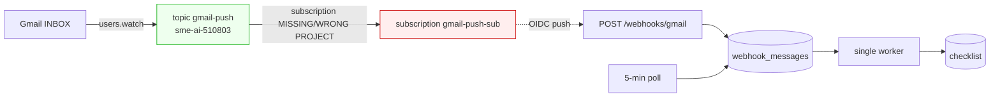

# T-046 — webhook built; one GCP project mismatch left

**Session:** 2026-10-28 · S07 · reply 2
**Register:** `todo/✅ T-046.md` · **Previous:** `1_webhook-handoff.md`
**State:** code complete and deployed; live push blocked by a Pub/Sub project mismatch.

## 1. What is live now

| Piece | Evidence |
|---|---|
| `POST /webhooks/gmail` | `https://hook.empi.site/webhooks/gmail` → **401** on a tokenless POST (was 404) |
| OIDC guard | audience + service-account check; missing config, bad token, wrong account → 401 |
| Payload guard | bad JSON / bad base64 / no `historyId` → 400; history failure → 500 retry |
| Dedupe | same Pub/Sub `messageId` processed once (`webhook_events`) |
| One queue | webhook + polling both enqueue into `webhook_messages`; one worker |
| Startup | `combined.py` starts the worker + watch renewal; a failed renewal retries in 5 min |
| Watch | live on `projects/sme-ai-510803/topics/gmail-push`, history `63073`, expires ~2026-11-04 |
| Polling | on every 5 min as fallback (`ENABLE_AUTO=true`) |
| Tests | **105 pass**, 24 new in `tools/test_webhook.py` |

The 4 unread press emails that were waiting were processed through the new queue as a live
proof: 4 polled → 4 queued → **4 done** (MSECC, BigSeller, Rolls-Royce, EXIM Bank; all
`readyToFilter=true`, checklist ids 399–402). Time per email ~30–60 s, one at a time.

✅ nothing to decide.

## 2. The mismatch the watch exposed

`users.watch` returned:

> `Invalid topicName does not match projects/sme-ai-510803/topics/*`

Gmail only accepts a topic in the **same GCP project as the OAuth client** behind
`creds/gmail.json`. That project is `sme-ai-510803`, not `msme-news-webhook`. A watch on
`projects/sme-ai-510803/topics/gmail-push` succeeded immediately, which proves the topic
exists and the mailbox may publish to it. But a **subscription created in
`msme-news-webhook` cannot attach to a topic in `sme-ai-510803`**, so no push is delivered.

Measured: I inserted an inbound test message (`1a18168b35321ab1`, external From). Gmail
history showed it, the endpoint received **zero** requests, `webhook_events` stayed empty.
The two synthetic test messages are now in Trash. Polling still sees new mail within 5 min.

- **Blocks:** the live push proof only. Endpoint, queue and polling work; polling covers
  new mail with up to a 5-minute delay. Needed before the end-to-end test.
- **What it means:** in project `sme-ai-510803`, create (or fix) subscription `gmail-push-sub`
  on topic `gmail-push`:
  - delivery type **Push**
  - endpoint `https://hook.empi.site/webhooks/gmail`
  - **Enable authentication**, audience `https://hook.empi.site/webhooks/gmail`
  - service account: choose A or B below.
- **Real example:** a release arrives at 10:00. Gmail publishes to the topic; the subscription
  POSTs it; the handler verifies the token, replays history, enqueues; the worker finishes in
  ~30–60 s. Without it, the 10:00 mail is first seen by the 10:05 poll.
- **Options:**
  - **A (recommended)** keep `msme-webhook-push@msme-news-webhook.iam.gserviceaccount.com`
    and grant that service account `roles/iam.serviceAccountTokenCreator` to the
    `sme-ai-510803` Pub/Sub service agent (`service-<project-number>@gcp-sa-pubsub...`).
    No code change.
  - **B** create a service account inside `sme-ai-510803`, use it in the subscription, and
    tell me its email — I change `WEBHOOK_SERVICE_ACCOUNT` and redeploy.
  - **C** skip push and rely on 5-minute polling. No GCP work, but no instant processing and
    the webhook code stays dormant.
- **Effect of not deciding:** no push ever arrives; the service still works on the 5-minute
  poll. The watch renews every ~6 days and costs nothing.
- **For reference only:** `todo/✅ T-046.md`, `docs/PRODUCTION-EMAIL-SETUP.md`.

⭐ **Decision — §2: where to create the push subscription.** (A recommended.)

## 3. Files changed

- `webhook_gmail.py` — new handler (OIDC, decode, dedupe, history, enqueue, retry).
- `dashboard.py` — public `POST /webhooks/gmail`; `/api/health` now says `"webhook": true`.
- `combined.py` — starts the queue + watch renewal in lifespan.
- `scheduler.py` — polls into the queue instead of running the pipeline itself.
- `receive_queue.py` — renewal retries in 5 min on error (was 6 h).
- `docker-compose.yml` — webhook env, `ENABLE_AUTO=true`, fixed-address replies.
- `requirements.txt` — `PyJWT`, `cryptography` (Google's JWK verification).
- `docs/PRODUCTION-EMAIL-SETUP.md` — records the same-project rule.
- `todo/✅ T-046.md`, `NOW.md` — state and the remaining external step.

✅ nothing to decide.

## 4. Parked this turn

- Container DNS is intermittently flaky (`Unable to find the server at
  gmail.googleapis.com`, retried successfully). The watch loop now retries; polling also
  catches it. No action proposed.
- `docker update --restart unless-stopped wonderful_murdock` and tunnel-token rotation stay
  in `T-046` (already known).

✅ nothing to decide.

## 5. What I recommend next

Do **§2 option A** in the Cloud console (2 minutes), then reply **“subscription created”**.
I will insert one external-looking test message and confirm `[webhook] ... history: 1 id(s)`
in the log, then remove it. Keep this session open — no compaction needed; the next step is a
short verification, **low thinking effort**.

## Recap

| Question | Answer |
|---|---|
| Is the endpoint live? | Yes — 401 without a token, 200 with a valid push |
| Is the code complete? | Yes — 105 tests pass |
| Is push delivering? | **No** — subscription is in the wrong project |
| Is the mailbox still processed? | Yes — 5-minute polling; 4 waiting emails finished this session |
| What is needed? | Create the push subscription in `sme-ai-510803` (decision §2) |
