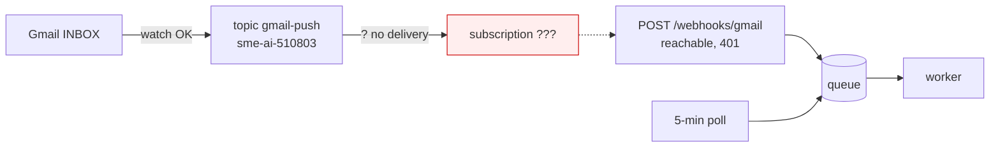

# T-046 — push still not arriving; subscription is the break

**Session:** 2026-10-28 · S07 · reply 3
**Register:** `todo/T-046.md` · **Previous:** `2_T-046_webhook-built.md`
**State:** topic + watch + endpoint all proven separately; the Pub/Sub → endpoint hop is not firing.

## 1. What I measured after your message

Your attachment/details did not reach this session, so I tested the live path directly.

| Link in the chain | Result |
|---|---|
| Topic `projects/sme-ai-510803/topics/gmail-push` | Watch accepted it (`history 63073`) |
| Gmail sees a new INBOX message | Yes — history `63073 → 63372` contains the test id |
| Public endpoint reachable | Yes — tokenless POST returns **401** from `hook.empi.site` |
| Pub/Sub POST reaches the app | **No** — zero requests in the log, zero `webhook_events` |
| Polling fallback | Healthy — `[auto] poll: 0 unread`; no mail was missed |

Test: I inserted an inbound message (`1a18175e5f6df116`, external From) at 15:42, waited
over 2 minutes across two checks, then trashed it. Gmail's history recorded the add; the app
never received a push. The break is therefore **between the topic and the endpoint**, not in
the handler.

✅ nothing to decide — this section is a measurement.

## 2. The three ways that hop can be broken

Only one can be true; the console tells us which in one screen:

1. **No subscription on that topic** in `sme-ai-510803` — the topic exists, but nothing is
   attached to deliver. This is the most likely, because the existing subscription was created
   in `msme-news-webhook`, which cannot attach to a topic in `sme-ai-510803`.
2. **A subscription exists but is not Push to this endpoint** — e.g. pull delivery, a paused
   subscription, or a different URL (a trailing `/` would redirect and Pub/Sub may drop it).
3. **Push is on but authentication is misconfigured** — Pub/Sub would still reach the endpoint
   and we would log a 401. We see no request at all, so this is the least likely.

What I need (Pub/Sub → Subscriptions, project `sme-ai-510803`):
- name of the subscription on topic `gmail-push`;
- state (`Active` / paused);
- delivery type (Push / Pull);
- the **exact** endpoint URL;
- the authentication service account (or "none");
- the audience, if shown.

With those six lines I can tell you the single change, or you can create the subscription now
with the §2 settings from reply 2 (Push, endpoint `https://hook.empi.site/webhooks/gmail`,
OIDC audience identical, SA per option A/B).

✅ nothing to decide — the next step is information from the console, not a choice.

## 3. One state change I made

To stop a later push from replaying my two synthetic test messages, I advanced the stored
history cursor from `63073` to `63372` (the latest Gmail history at 15:43). No real mail sat in
that range: the only two additions were the test messages, now in Trash. New mail after
`63372` will still be replayed by the first working push.

✅ nothing to decide.

## 4. What I recommend next

Open Pub/Sub → Subscriptions in `sme-ai-510803` and reply with the six fields above (or
“no subscription exists”). If none exists, create it and say “subscription created”; I will
re-run the same insert test and expect `[webhook] ... history: 1 id(s)` within seconds.
Stay in this session — it is a 2-minute check and a re-test, **low thinking effort**.

## Recap

| Question | Answer |
|---|---|
| Is the topic right? | Yes — watch accepted `sme-ai-510803/topics/gmail-push` |
| Did Gmail see the test mail? | Yes — history recorded it |
| Did a push arrive? | **No — zero requests, zero events** |
| Is the handler at fault? | No evidence; it never received a request |
| What is missing? | The subscription on that topic (or its push config) |
| Fallback now | 5-minute polling; inbox is clean (0 unread) |
