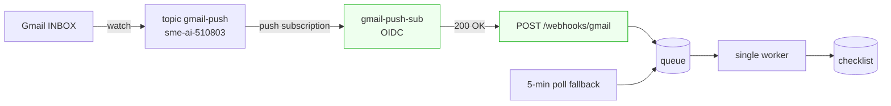

# T-046 — push is live and proven end to end

**Session:** 2026-10-28 · S07 · reply 5
**Register:** `todo/T-046.md` (closed) · **Previous:** `4_T-046_push-vs-pull.md`
**State:** closed; only two operational chores remain.

## 1. What the new subscription exposed

The new subscription arrived with a **new** service account:
`msme-webhook-push@sme-ai-510803.iam.gserviceaccount.com`. The handler's exact-match guard
rejected it with 401 (`unexpected service account`), which is the guard doing its job. I changed
`WEBHOOK_SERVICE_ACCOUNT` in `docker-compose.yml` to that account and redeployed. No other code
change was needed.

✅ nothing to decide.

## 2. Live proof

One inbound message (`1a1818571c4e2ecd`, external From) was pushed through the full chain:

| Step | Evidence |
|---|---|
| Gmail → topic | watch on `projects/sme-ai-510803/topics/gmail-push` |
| Pub/Sub → endpoint | `POST /webhooks/gmail` **200 OK** |
| OIDC | accepted with the `sme-ai-510803` service account |
| History replay | `[webhook] ... history: 1 id(s), 1 queued` (history `63580`) |
| Queue | row `1a1818571c4e2ecd`, `source=webhook` |
| Worker | processed it; queue row `done` |

Also re-checked: public endpoint **401** without a token; `webhook` flag true; **105 tests pass**;
watch stored (`history 63674`); inbox **0 unread**.

✅ nothing to decide — the build target is met.

## 3. Cleanup of the test data

The four real press emails processed earlier stay (checklist 399–402). Everything synthetic was
removed: test messages moved to Gmail Trash, the two `all_emails/TEST - …` folders deleted, and
the matching checklist / runs / pipeline rows deleted. No test rows remain; `webhook_events`
keeps the push log as evidence.

✅ nothing to decide.

## 4. What is left (operational only)

- `docker update --restart unless-stopped wonderful_murdock`
- Rotate the Cloudflare tunnel token that was exposed in chat.

Polling stays on every 5 minutes as the fallback for a missed push; nothing to change.

✅ nothing to decide.

## 5. What I recommend next

Do the two chores above; the webhook itself needs nothing further. No new session required —
**low thinking effort**. If you later switch mailboxes, follow `docs/PRODUCTION-EMAIL-SETUP.md`:
the OAuth project must own the topic.

## Recap

| Question | Answer |
|---|---|
| Is push delivering? | **Yes — 200, 1 id replayed, processed via `source=webhook`** |
| Why did it 401 before? | The subscription used a new `sme-ai-510803` service account |
| Code change needed? | Only the configured service-account email |
| Tests | 105 pass |
| Test data | Removed; 4 real processed emails kept |
| Remaining | Cloudflare restart policy + tunnel-token rotation |
