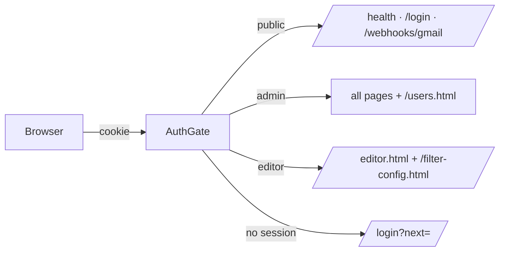

# T-047 — login, roles, audit and versioned filter config are live

**Session:** 2026-10-28 · S07 · reply 7
**Registers:** `todo/✅ T-047.md` (closed), `decisions/D37.md`
**State:** built and verified live; the auth layer is the second git commit.

## 1. What was built

- **`auth.py` + `combined.py`** — one gate for both apps. Public paths only:
  `/health`, `/api/health`, `/login`, `/login.html`, `/api/auth/login`,
  `/webhooks/gmail`, `/auth.js`. Everything else needs a session; the webhook keeps its
  Pub/Sub OIDC auth.
- **Roles** — `admin` reaches everything. `editor` reaches only `/editor.html`,
  `/api/editor/*`, `/filter-config.html` / `/config.json` / `/filters.json` (and reading
  `/config-versions`) plus draft images under `/repurpose-site/`. All other paths 403.
- **Sessions security** — 7-day `HttpOnly` + `Secure` + `SameSite=Lax` cookie; only a
  SHA-256 hash is stored. CSRF required on every non-GET except login and the webhook.
- **Passwords** — stdlib scrypt, per-user salt, min 12 chars; 5 failures / 15 min lock;
  unknown usernames still pay a dummy hash (no enumeration).
- **Accounts** — `/login`, `/account.html` (own password), `/users.html` (admin:
  create, role, disable, reset, audit). Users are disabled, never deleted; the last active
  admin cannot be removed. Admin-created users must change the password at first sign-in.
- **Filter-config versions** — every `/config.json` save (and testfilter promote/sync/
  rollback) records actor, time, full battery snapshot and hash. Restore is admin-only and
  creates a **new** version (`restored_from`); history is never rewritten. The endpoint now
  accepts only `ENABLE_LLM_ASSIST` / `ACCEPT_THRESHOLD` as settings — an editor can no
  longer smuggle receive keys or the Gmail query through it.
- Corrected two stale always-loaded rules: one entrypoint on :8899 (not three apps), and
  Repurpose is external (D35), not “not built”.

✅ nothing to decide.

## 2. Evidence

| Check | Result |
|---|---|
| Tests | **138 pass** (105 + 33 new auth tests) |
| Anonymous `/` | 302 → `/login?next=/` |
| Anonymous `POST /api/run` | 401 |
| `POST /webhooks/gmail` | 401 without OIDC (not a login redirect) |
| Admin login | 200; 7-day cookie with HttpOnly + Secure |
| Admin pages | `/`, `/users.html`, `/account.html`, `/filter-config.html`, `/config.json`, `/config-versions`, `/api/users`, `/api/audit` → 200 |
| CSRF | logout without header 403; with header 200 |
| Forced password change | `/` → 302 `/account.html`; `/auth.js` still 200; `/api/users` 403; after clearing, `/` 200 |
| Webhook regression | real push 200, event `done`; watch/queue untouched |

The live checks ran through `https://hook.empi.site`; the webhook test message was trashed
and no checklist/archive rows were left behind.

✅ nothing to decide.

## 3. Operation — first login

- Sign in at `/login` as **`hisham`**. The bootstrap password is
  `AUTH_BOOTSTRAP_PASSWORD` in the gitignored `.env` (not printed here or in chat).
- Change it on `/account.html`, then remove `AUTH_BOOTSTRAP_USERNAME` and
  `AUTH_BOOTSTRAP_PASSWORD` from `.env`. They are ignored once a user exists, but removing
  them prevents a re-created database from reusing the old bootstrap password.
- Create editor accounts on `/users.html`; their initial password must be changed at first
  sign-in. Editors see the editor page and filter config only.
- `data/` now also holds users and sessions (gitignored): include it in backups.
- `COOKIE_SECURE=true` in production (tunnel is HTTPS). Set `false` only for direct
  `http://localhost` use.

✅ nothing to decide.

## 4. Git — the auth commit is ready

`87b4cd0 baseline: AI_News service — receive, filter, repurpose + Gmail Push webhook` is on
`origin/main` (private repo). The auth work is **31 modified + 8 new files**, unstaged;
`.env` is ignored and the secret scan is clean.

The profile still denies `git commit*` / `git push*`, so I could not land it.

⭐⭐ **Decision — §4: how to land the auth commit**
- **Blocks:** the auth layer on the remote. Everything is implemented and tested.
- **Option A (recommended):** run:
  ```bash
  git add -A
  git commit -m "feat(auth): local login, admin/editor roles, versioned filter config" \
             -m "T-047; D37; 138 tests."
  git push
  ```
- **Option B:** allow `git commit*` / `git push*` in `opencode.json`, then say “go again”.
- **Effect of not deciding:** the login runs live but is not versioned on the remote; a
  database loss or rollback would not restore the auth code.
- **Reference:** `todo/✅ T-047.md`, `decisions/D37.md`.

## 5. What I recommend next

Land §4, then log in, change the admin password and create the first editor. Test one
editor login: `/editor.html` and `/filter-config.html` work; `/` and `/users.html` are 403.
Rotate the Typesafe key and remove the bootstrap lines from `.env` in the same sitting.
Continue in this session — **low thinking effort**.



## Recap

| Question | Answer |
|---|---|
| Can users log in? | Yes — `/login`, 7-day HttpOnly/Secure session |
| Are roles enforced? | Yes — admin all; editor page + filter config only |
| Are changes attributed? | Yes — `audit_log` + full `filter_config_versions`; restore is a new version |
| Is the webhook still public? | Yes — OIDC only; regression push returned 200 |
| Tests | 138 pass |
| First admin | `hisham`; bootstrap password in `.env`, change it |
| What is left? | Land the auth commit (blocked by the permission profile) + operational chores |
