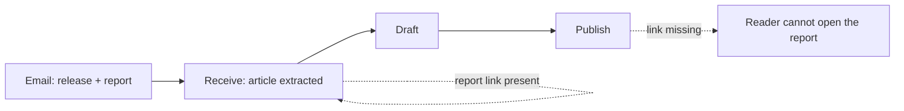

# 1 — N-3 report link: checked and added to `NEXT_MEETING.md`

_2026-11-04 (S12) · doc-only change · no code touched._

## 1. What was verified

| Check | Result |
|---|---|
| Live article | `.../digital-2027-report-one-in-three-people-globally-use-genai-as-social-media-users-hit-5-8-billion/` is live, `datePublished 2026-10-27T13:35:18Z` |
| Report link on the live page | **0** matches for `wearesocial` or `meltwater` in the full HTML |
| Release copy we archived | `all_emails/received-2026-10-15-and-above/Fifteen years…6.15 billion _1/Digital-2027-Report-….md:25-26` carries `wearesocial.com/digital-2027` and `meltwater.com/en/global-digital-trends`; the DOCX hyperlink rels carry both |
| Email example | “Fwd: Fifteen years of Digital reports: Meltwater & We Are Social’s 2027 edition shows 6.15 billion online and 1 in 3 people using generative AI”, Thu 22 Oct, thread `1a162cc0b30af0e7`, checklist rows 377/378 |
| Rule source | 30-Oct transcript 16:46–18:42: “if this report is too long, what we do is we just create a link… as long as it's a report… include the link in the published article” |

**Correction recorded in the issue:** the earlier brief said the AI reported “no article”. The archive row is `hasArticle=true`; the call’s red flag was **“no media” + an AI-credit (402) error**, not a no-article verdict. The issue now states the real gap — the link is lost at publish.

### Web-link emails found (added to the issue)

No email says “the article is on this link”; the literal wording is “full release and photos” or “press release **HERE**”.

| Email | Literal quote | Row | Link |
|---|---|---|---|
| Three lessons from Hangzhou (Sanct Social) | “Please click on the link below to access full release and photos” | 242 | `vritimes.com` |
| BigSeller 11.11 | same | 400 | `vritimes.com` |
| Labuan IBFC | same | 372 | `vritimes.com` |
| Indonesian delegation (16 companies) | same | 247 | `vritimes.com` |
| IMAGO PaperSmart | same | 257 | `vritimes.com` |
| Sanct Social now available | same | 245 | `vritimes.com` |
| Momcozy 11.11 | same | 408 | `vritimes.com` |
| ConverXion KL 2026 | same | 320 | `vritimes.com` |
| Fast Retailing | “Kindly find the press release **HERE**” | 240 | Google Drive |
| Aventra / Media OutReach | “Click to download” | — | `release.media-outreach.com` |
| Finnfund / Cision | link to the original release page | — | `news.cision.com` |

Source: `docs/negative-dataset.json` body text; the system already fetches this kind of link in **23 runs**.

✅ nothing to decide — measurement only.

## 2. What changed

`docs/meetings/2026-10-30/NEXT_MEETING.md` (the staging file for the next call):

- **§2 Issues to raise** — new bullet `[HS 2026-11-04]` with the email example, the rule, the 0-link gap, the web-link examples, and the ask.
- **§3 MSME design decisions** — new row `N-3`: *long reports: publish the link to the report* · **verified gap** · ruling + owner + placement.

No other file touched. No register id changed, so no index rebuild; no `.py` changed, so no compile/tests needed.

✅ nothing to decide — the edit is exactly what was approved.

## 3. The question for MSME

**What it means operationally:** every report-type release (Meltwater, MDEC, MDAAC and similar) must publish with a working link to the full report. Today the link survives Receive but disappears by Publish, so the reader cannot “read more”.

**Real example:** the 22-Oct Meltwater email offered the press release plus the full Digital 2027 report. The release DOCX had `wearesocial.com/digital-2027` and `meltwater.com/en/global-digital-trends`; the live 27-Oct article has neither.

**Effect of not deciding:** every future report article keeps shipping without its link; editors keep doing it by hand, inconsistently, and the AI has no rule to follow.

**Options:**
- **A (recommended)** — the system carries a `reportUrl` through draft → publish and adds “Read the full report: <link>” at the end; the editor path gets the same rule. Owner: EF builds, MSME confirms wording/placement.
- **B** — editor-only rule: MSME adds the link manually at publish; no system change.
- **C** — link inline in the body where the report is first mentioned; needs a location rule per article.

**Recommendation:** **A**, with the link at the end of the body. It is the only option that survives a zero-touch publish (M-4).

**Blocks:** stage-3 publish go-live. Needed before the next batch is published, not before the meeting.

**Register:** `docs/meetings/2026-10-30/NEXT_MEETING.md` §2–§3 (the call’s record stays in `MEETING-BRIEF-2026-11.md` §3 N-3).

⭐ Decision — §3: **A / B / C** for the report link, and who inserts it.

## 4. To-do list and delivery date

Created `todo/🟢 T-049.md` — **Deliver the N-rules from the 30-Oct MSME call**.

**Delivery date: 2026-11-09 (Monday).** Basis: the next call is planned for the week of
2026-11-09 (`T-037`) and the 30-Oct call said “~1.5 weeks” from 30 Oct. The exact call date
is not fixed; if MSME moves it, the date moves with it.

- **2026-11-09:** N-2 library update, N-3 report link, N-4 government summary, N-5
  contribute, N-6 Gmail link, N-9 cost test.
- **2026-11-16:** N-1 gallery (needs MSME's images) and N-7 chunk rules (engine repo).
- **At the call:** N-8 agent name, N-3 link placement.

`todo/INDEX.md` regenerated (49 items, 2 open).

⭐ Decision — §4: confirm **2026-11-09** as the delivery date, or give the real call date.

## 5. What I recommend next

**Carry on in this session** (low effort): start with N-3 (`reportUrl`) and N-6 (Gmail link),
the two smallest items, then N-2/N-4/N-5.

Reason: the evidence is fresh and the meeting date is close; no compaction needed.

| # | Item | State |
|---|---|---|
| 1 | Live page has no report link | verified (0 URLs) |
| 2 | Release DOCX has both links | verified |
| 3 | `NEXT_MEETING.md` §2 issue + web-link examples | done |
| 4 | `NEXT_MEETING.md` §3 row added | done |
| 5 | `todo/🟢 T-049.md` + `todo/INDEX.md` | done |
| 6 | Delivery date 2026-11-09 | proposed — confirm |
| 7 | MSME ruling A/B/C | open — next call |
