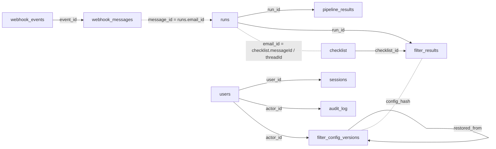

# 49 — Database tables and connections

_2026-11-06 (S14) · docs only · no code touched._

## 1. What changed

`docs/workflow/DATABASE-FLOW.md` gained **§2.1 Connections**:

- a mermaid diagram of the table links;
- a join table: from → to → key → meaning;
- the note that this SQLite file has **no declared foreign keys** — every link is an ID in code;
- the note that `checklist` has no `run_id` column (the run is found via `messageId`/`threadId`).

✅ nothing to decide — this is the requested view.

## 2. The tables

| Table | Rows now | What it holds |
|---|---|---|
| `checklist` | 241 | one row per processed email: 14 columns + reply + Gmail ids |
| `runs` | 355 | one row per receive attempt (`email_id`, status, model, error) |
| `pipeline_results` | 251 | the full stage trace + row JSON for one run |
| `filter_results` | 24 | filter verdicts (outcome, score, gates, battery, article hash) |
| `filter_config_versions` | 2 | every filter-config save/restore snapshot |
| `users` | 3 | admin/editor accounts |
| `sessions` | 4 | hashed login sessions + CSRF |
| `login_attempts` | 3 | lockout counters |
| `audit_log` | 68 | who changed what |
| `gmail_watch` | 1 | the single Pub/Sub watch |
| `webhook_events` | 36 | Pub/Sub events (dedupe) |
| `webhook_messages` | 13 | the queue of Gmail ids to process |

## 3. The connections

| From | To | Key |
|---|---|---|
| `pipeline_results.run_id` | `runs.id` | 1:1 |
| `filter_results.checklist_id` | `checklist.id` | N:1 |
| `filter_results.run_id` | `runs.id` | N:1 |
| `filter_results.threadId` | `checklist.threadId` | N:1 |
| `webhook_messages.event_id` | `webhook_events.event_id` | N:1 |
| `webhook_messages.message_id` | `runs.email_id` | 1:1 |
| `runs.email_id` | `checklist.messageId` / `threadId` | logical |
| `sessions.user_id` | `users.id` | N:1 |
| `audit_log.actor_id` | `users.id` | N:1 |
| `filter_config_versions.actor_id` | `users.id` | N:1 |
| `filter_config_versions.restored_from` | `filter_config_versions.id` | self |
| `filter_results.config_hash` | `filter_config_versions.config_hash` | logical |
| `audit_log.target_id` | varies | polymorphic (`target_type`) |

## 4. Verification

| Check | Result |
|---|---|
| Table list | read from `data/msme.sqlite3` (`.tables`) |
| Counts | measured read-only just now (241 / 355 / 251 / 24 …) |
| Join keys | checked against `db.py`, `editor_data.py`, `repurpose_export.py` |
| Code changed | **0** |

✅ nothing to decide — measured.

## 5. What I recommend next

**Carry on in this session** (low effort): the N-7/N-8/N-9 notes.
Reason: they are the last short items before the 11-Nov call.

| # | Item | State |
|---|---|---|
| 1 | Tables + connections documented | done |
| 2 | Live Gmail token (`T-028`) | **open — user action** |
| 3 | N-7 / N-8 / N-9 | next |
