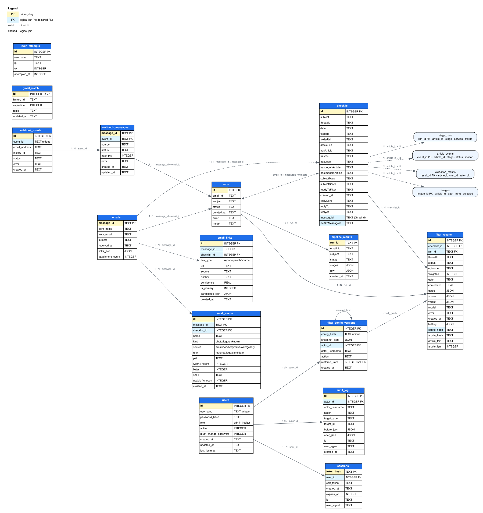

# 51 — Table graph with columns and relationships

_2026-11-06 (S14) · docs + generated graph · no code touched._

## 1. What changed

| File | Change |
|---|---|
| `docs/workflow/database-schema.dot` (new) | Graphviz source: all 12 tables, every column, PK/FK colours, labelled edges |
| `docs/workflow/database-schema.svg` (new, 76 KB) | the visual graph |
| `docs/workflow/database-schema.png` (new, 530 KB) | same graph as a raster image |
| `docs/workflow/DATABASE-FLOW.md:92` | §2.2 Table graph with the embedded SVG + links |
| `docs/INDEX.md` | `DATABASE-FLOW.md` row now mentions the graph files |



## 2. How to read it

- **Blue header** = table name.
- **Yellow row** = primary key (`PK`).
- **Blue row** = logical link (`FK`); this SQLite file declares **no foreign keys** — the joins are IDs
  in code.
- **Solid edge** = a direct id.
- **Dashed edge** = a logical join (`email_id = messageId / threadId`, `config_hash`).

The main links:

```text
runs.id            ← pipeline_results.run_id      1 : 1
runs.id            ← filter_results.run_id        1 : N
checklist.id       ← filter_results.checklist_id  1 : N
webhook_events.event_id ← webhook_messages.event_id  1 : N
webhook_messages.message_id → runs.email_id       1 : 1
runs.email_id      ↔ checklist.messageId / threadId   logical
users.id           ← sessions.user_id             1 : N
users.id           ← audit_log.actor_id           1 : N
users.id           ← filter_config_versions.actor_id  1 : N
filter_config_versions.id ← itself (restored_from)
filter_config_versions.config_hash ↔ filter_results.config_hash  logical
```

Standalone tables: `gmail_watch` (one row) and `login_attempts` (by username/ip).

## 3. Verification

| Check | Result |
|---|---|
| Graphviz render | `dot -Tsvg` + `dot -Tpng` — **OK** |
| Tables in the graph | **12** |
| Columns | all, including migration columns (`replySent`…, `messageId`, `rfc822MessageId`) |
| Image size | SVG 1601 × 1494 pt · PNG 530 KB |
| Doc embed | `DATABASE-FLOW.md:92` resolves to `database-schema.svg` |
| Code changed | **0** |

✅ nothing to decide — the graph is generated and linked.

## 4. What I recommend next

**Carry on** (low effort): the N-7/N-8/N-9 notes, then the 11-Nov call.
Reason: the schema/graph work is now complete.

| # | Item | State |
|---|---|---|
| 1 | Tables + columns + relationships graph | done |
| 2 | Full DDL in `DATABASE-FLOW.md` §9 | done |
| 3 | Gmail token (`T-028`) | **open — user action** |
| 4 | N-7 / N-8 / N-9 | next |
